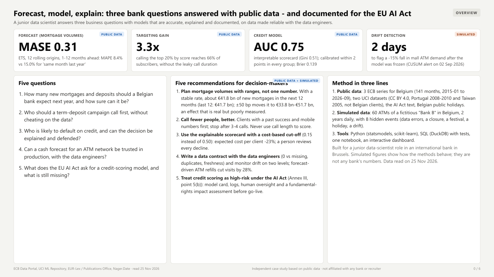

# Forecast, model, explain: three bank questions answered with public data - and documented for the EU AI Act

**[Read the report (PDF)](https://albt-france.github.io/bank-forecasting-credit-ai-act-case-study/report/bank_ds_case_study.pdf) · [Open the interactive dashboard](https://albt-france.github.io/bank-forecasting-credit-ai-act-case-study/dashboard/)**

<sub>Links in the repository: [site/report/bank_ds_case_study.pdf](site/report/bank_ds_case_study.pdf) · [site/dashboard/index.html](site/dashboard/index.html)</sub>

An independent case study built for a junior data-scientist role in an international bank in Brussels. A junior data scientist answers three business questions - **how much will we lend, who do we call, who may default** - with models that are accurate, explained and documented, on data made reliable with the data engineers. Public data (ECB, UCI, EU AI Act) and a **simulated** ATM network of a fictitious "Bank B".

## Key results

| | Result | Data |
|---|---|---|
| **Forecast** | ETS forecasts new Belgian mortgage volumes 1-12 months ahead with **8.4% MAPE (MASE 0.31)** on 12 rolling origins, vs 15.0% for "same month last year". Next 12 months: **€41.8 bn** at a stable rate, €33.8-51.7 bn for ±50 bp. | PUBLIC DATA |
| **Targeting** | Calling the **top 20%** of clients by score reaches **66% of subscribers (3.3x random)** - without the call duration, a leak that would push the AUC from 0.82 to 0.95. | PUBLIC DATA |
| **Credit risk** | An explainable scorecard: **AUC 0.75**, calibrated within 2 points, cost-based cut-off 0.15 (expected cost **-23%** vs 0.50), fairness measured by sex and age. | PUBLIC DATA |
| **Production** | Data checks catch a feed outage recorded as zeros and a duplicate reload, **ignore Easter Monday**, and the monitor flags a mall demand drift **2 days** after it starts; forecast-driven refills need 28% fewer visits. | SIMULATED |



## Methods

- **Forecasting** (`src/forecast_bank_series.py`): seasonal naive, ETS and SARIMAX with the mortgage rate as exogenous variable; rolling-origin backtest (12 origins, horizons 1-12); MAPE, MASE, 80% and 95% interval coverage; three rate scenarios; a dated break in deposits (least squares, Chow test), described by date and size only.
- **Targeting** (`src/bank_marketing_model.py`): logistic regression and gradient boosting without `duration` (known only after the call); cumulative gain; out-of-time robustness check; business segments in SQL.
- **Credit** (`src/credit_default_model.py`): logistic scorecard on binned inputs and a boosting challenger; AUC, Gini, KS; calibration and Brier; cost-based cut-off; permutation importance and partial effect; fairness by sex and age band (not model inputs; aggregates of 5 or more); PSI.
- **Production** (`src/data_quality.py`, `src/atm_forecast.py`, `sql/`): declared data checks agreed with the data engineers; DuckDB staging (dedupe, 0 → NULL); global gradient boosting with calendar, Belgian public holidays, events and lags; rolling-origin validation vs a shuffled split; two-level CUSUM drift monitor; refill policy by cost; Simpson's paradox.
- **Documentation** (`docs/`): [decision memo](docs/decision_memo.md), [model card](docs/model_card_credit_default.md), [AI Act checklist](docs/ai_act_checklist.md) (not legal advice), [forecasting note](docs/forecasting_note.md), [data contract](docs/data_contract_atm.md), [monitoring runbook](docs/monitoring_runbook.md), [glossary EN-FR](docs/glossary_fr_en.md), [data issues log](docs/data_issues_log.md), [assumptions](docs/assumptions.md).
- **Notebook**: [notebooks/bank_ds_case_study.ipynb](notebooks/bank_ds_case_study.ipynb), executed, with one backtest to re-run step by step.
- AI-assisted workflow: I used Claude, mainly to write scripts faster. I drove the project: I defined the questions, chose and validated the data sources, made the analytical decisions and checked every result.

## How to re-run

Python 3.10+, Windows, macOS or Linux; Microsoft Edge (or Chrome) to print the PDF. No API key is needed.

```bash
pip install -r requirements.txt
python src/collect_public.py
python src/simulate_atm.py
python src/data_quality.py
python src/run_sql.py
python src/forecast_bank_series.py
python src/bank_marketing_model.py
python src/credit_default_model.py
python src/atm_forecast.py
python src/build_dashboard.py
python src/build_pdf.py
```

`collect_public.py` downloads the public sources once (at most one request per second) into `data/raw/`, which is not published. Each model script re-runs the SQL files whose inputs exist; the last one runs `sql/99_tests.sql` (8 assertions). To refresh the notebook: `jupyter nbconvert --to notebook --execute --inplace notebooks/bank_ds_case_study.ipynb`.

## Sources and licences

| Source | Use | Licence / terms |
|---|---|---|
| ECB Data Portal: `BSI.M.BE.N.A.L21.A.1.U2.2250.Z01.E` (household overnight deposits, Belgium, EUR millions, `UNIT_MULT` = 6) | Deposits, break | ECB statistics, reuse with source |
| ECB Data Portal: `MIR.M.BE.B.A2C.A.R.A.2250.EUR.N` (rate on new mortgages, %) and `MIR.M.BE.B.A2C.A.B.A.2250.EUR.N` (new mortgage volume, EUR millions, `UNIT_MULT` = 6) | Forecast | ECB statistics, reuse with source |
| [UCI Bank Marketing](https://archive.ics.uci.edu/dataset/222/bank+marketing) (id 222): phone campaigns of a Portuguese bank, 2008-2010 | Targeting | CC BY 4.0 |
| [UCI Default of Credit Card Clients](https://archive.ics.uci.edu/dataset/350/default+of+credit+card+clients) (id 350): card holders in Taiwan, 2005 | Credit | CC BY 4.0 |
| [Regulation (EU) 2024/1689](https://publications.europa.eu/resource/celex/32024R1689) (AI Act) | Checklist | EU law, reuse with source |
| [Nager.Date](https://date.nager.at) public holidays, Belgium | ATM simulation | Open API |

All data read on 25 Nov 2026 (`data/sources_log.csv`). The UCI datasets are **not Belgian clients**: they show the method, not Belgian risk levels.

## Limits

- Public datasets are old and foreign; the ATM network is simulated and has the patterns put into it.
- 141 monthly points: the rate effect is measured with a wide interval, and breaks cannot be forecast.
- Cost matrices, the closure transfer share and refill costs are assumptions to be set with the business.
- The AI Act checklist is a data scientist's working list, **not legal advice**; later amendments to the Regulation were not checked.

---

Independent case study based on public data · not affiliated with any bank or recruiter
